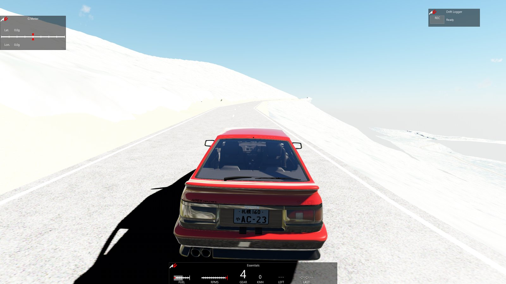
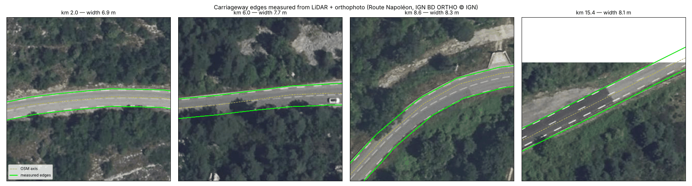
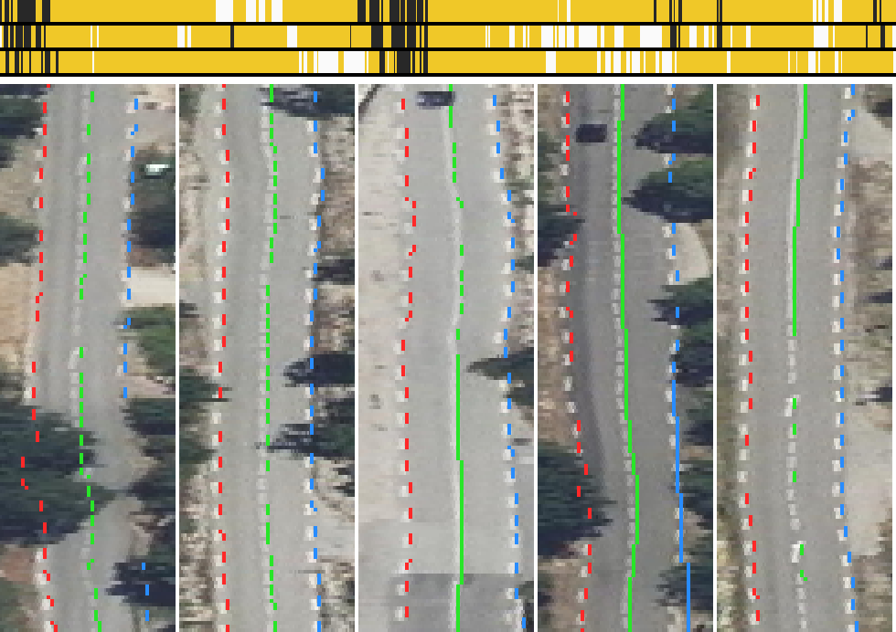
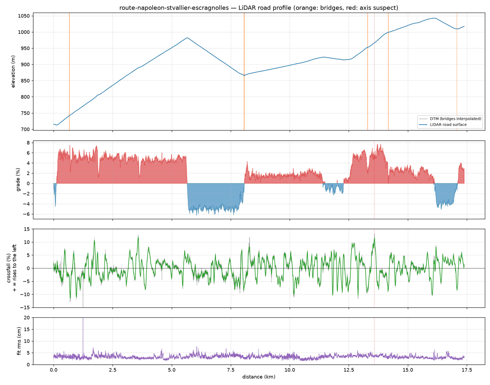
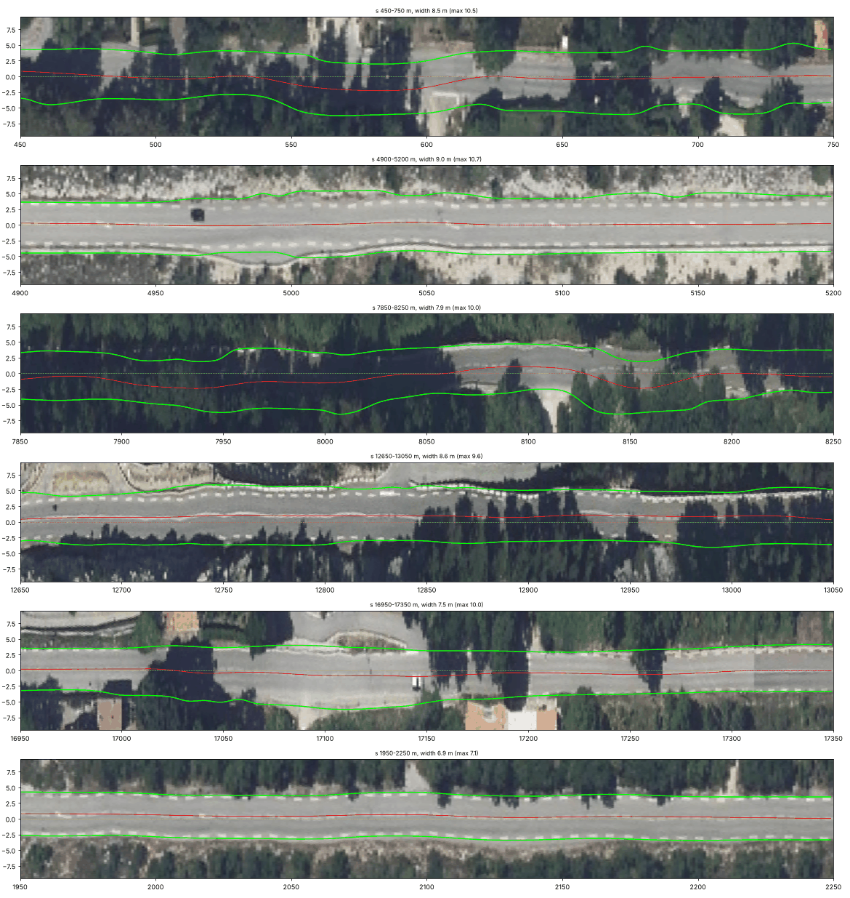

# realroad

**🇫🇷 [Français](#-français) · 🇬🇧 [English](#-english) · 📘 [Tutoriel / Tutorial](docs/TUTORIAL.md) · 📍 [État / Status](docs/STATUS.md)**

Routes réelles → pistes de simulation, générées automatiquement à partir de
données ouvertes. / Real-world roads → driving-sim tracks, generated
automatically from open data.

Auteur / Author : **Aymeric Duchene**

| En jeu — départ de Saint-Vallier / In game — leaving Saint-Vallier | Après l'épingle / After the hairpin |
|---|---|
|  |  |

*Premier essai (v0.1) : géométrie réelle, textures du terrain encore à régler. / First drive (v0.1): real geometry, terrain textures still to fix.*





*Marquages détectés (rouge : rive droite, vert : axe, bleu : rive gauche) sur l'orthophoto « déroulée » ; en haut, tout le tracé : blanc = continu, jaune = pointillés, gris = rien. / Detected markings (red: right edge, green: centre, blue: left edge) on the unrolled orthophoto; top, the whole road: white = continuous, yellow = dashed, grey = none.*

| Profil LiDAR de la route / LiDAR road profile | Route « déroulée » / Unrolled road |
|---|---|
|  |  |

---

## 🇫🇷 Français

### L'idée

Rouler dans un simulateur (Assetto Corsa) sur les routes qu'on connaît, avec
leur vraie géométrie : pente, dévers, virages, bosses. Au lieu de modéliser
chaque route à la main pendant des mois, `realroad` la génère à partir des
données publiques de l'IGN (LiDAR HD, BD TOPO, orthophotos) et
d'OpenStreetMap.

Premier tronçon : **Route Napoléon (D6085), Saint-Vallier-de-Thiey →
Escragnolles** (17,4 km, Pas de la Faye à ~980 m).

### Installation (Windows)

```powershell
cd realroad
python -m venv .venv
.venv\Scripts\activate
pip install -r requirements.txt
```

### Utilisation

Le tronçon se décrit dans `config.yaml` (points de départ/arrivée, numéro de
route, largeur du couloir…). Ensuite, une seule commande :

```powershell
python realroad.py --install "C:\Program Files (x86)\Steam\steamapps\common\assettocorsa"
```

Elle enchaîne toutes les étapes, qu'on peut aussi lancer une par une :

```powershell
python fetch.py osm      # tracé (OpenStreetMap, sinon BD TOPO IGN)
python fetch.py mnt      # relief LiDAR HD 50 cm (~16 Mo par km²)
python fetch.py ortho    # photos aériennes 20 cm
python fetch.py lidar    # nuage de points du couloir (~10 min, ~120 Mo gardés)
python fetch.py far      # relief et photos à basse résolution sur ~8 km (l'horizon)
python fetch.py mnh      # hauteur de la végétation (LiDAR HD) pour les arbres
python fetch.py buildings  # bâtiments BD TOPO (emprise, hauteurs)
python fetch.py streetview # photos 360° Panoramax le long de la route
python fetch.py roadside   # glissières, murets, panneaux, poteaux : OSM + points LiDAR hors sol
python road_profile.py   # vrai profil de la chaussée : altitude, dévers, ponts
python road_edges.py     # vrais bords de la chaussée : largeur et centre réels
python road_markings.py  # vrais marquages : ligne centrale et lignes de rive
python trees.py          # vrais arbres et buissons : position, hauteur, couronne, essence
python build_track.py    # géométrie de la piste (route, marquages, terrain, décor, départs AC)
python kn5_export.py --install "<dossier assettocorsa>"   # piste AC complète
python streetview_sheet.py # planche « vue conducteur » tous les 250 m, pour comparer avec le jeu
```

`kn5_export.py` écrit directement le `.kn5` (plus besoin de Blender ni de
ksEditor), l'AI line, la minimap, les caméras de replay et les vignettes de
Content Manager. `python realroad.py --from build_track` ne relance que les
dernières étapes.

Les téléchargements reprennent là où ils s'étaient arrêtés.
Les données vont dans `data/<nom-du-tronçon>/` (ignoré par Git).

### Comment ça marche

| Étape | Source | Détail |
|---|---|---|
| Tracé | OSM (Overpass) ou BD TOPO | Plus court chemin entre départ et arrivée sur les tronçons portant le numéro de route ; les ronds-points sans numéro sont recousus (≤ 60 m). |
| Relief | MNT LiDAR HD | Dalles 1 km², GeoTIFF float32 au pas de 50 cm, listées par la couche WFS `IGNF_LIDAR-HD_METADONNEE:metadata`. |
| Ponts | MNT | Le MNT est le sol nu et plonge sous les ponts : creux étroits repérés et interpolés (aperçu). La vraie altitude viendra des points LiDAR classe 17. |
| Profil route | Nuage LiDAR | Stations tous les 1 m ; droite robuste z = z0 + c·t sur ±2,5 m autour de l'axe → altitude, dévers, rugosité. Tabliers de pont (classe 17) prioritaires ; axe signalé suspect si dévers > 12 % ou rms > 12 cm. |
| Bords de chaussée | LiDAR + orthophoto + BD TOPO | Lignes de rive (pics d'intensité LiDAR + blanc sur l'ortho) → bord = ligne + 0,3 m ; ligne cachée reconstruite par symétrie autour de la ligne centrale ; saut d'intensité LiDAR dans le relief sinon ; BD TOPO comme garde-fou. Largeur médiane 7,35 m (6,3–9 m) sur la Route Napoléon. |
| Marquages | Orthophoto + LiDAR | Ligne centrale et lignes de rive suivies mètre par mètre (pic blanc sur l'ortho + pic d'intensité LiDAR), découpées en tronçons continus / pointillés / absents ; pointillés gardés là où ils sont vus, complétés au pas local. Bandes blanches 2 cm au-dessus du bitume. |
| Arbres | MNH LiDAR HD + orthophoto | Sommets = maxima locaux de la hauteur de végétation lissée (fenêtre qui grandit avec la hauteur), rayon de couronne lu sur le MNH, pin / feuillu / arbuste selon la hauteur et la couleur sur l'ortho ; billboards croisés (shader ksTree), textures générées dans les couleurs de l'ortho. ~50-120 arbres/ha mesurés sur le tracé. Près de la route : « cartes » de feuillage dans le volume de la couronne (plein sous tous les angles), sous-bois sous les arbres, troncs solides à moins de 7 m du bord. |
| Buissons, haies | MNH LiDAR HD | Végétation basse (0,6-3 m : garrigue, haies) à moins de 35 m de la route : un buisson par case de 2 m, masqués au-delà de 220 m. |
| Mobilier routier | Relief + OSM (+ LiDAR) | Parapets bas (0,65 m) côté vallée, là où le terrain tombe de plus d'1 m à moins de 2,5 m du bord sur au moins 20 m — c'est ce que montrent les photos Panoramax (vérifié sur 9 points : 8 justes) ; le LiDAR HD ne les voit presque pas (détection par points hors sol disponible mais désactivée : trop peu de points, falaises prises pour des murs). Glissières et murs OSM. Solides. Panneaux : limitations aux changements de `maxspeed` OSM, entrée / sortie de village avec le nom, STOP et cédez-le-passage. Balises J6 posées selon les règles (tous les 50 m, plus serrées en virage, hors village et hors glissière) : pas relevées. Poteaux et pylônes électriques (OSM). |
| Arbres 3D CSP | `trees3d.py` + Blender + Content Manager | Pins d'Alep (2 formes), chêne vert, arbuste générés (tronc et branches en tubes, feuillage en touffes, 3 niveaux de détail, textures diffuse + normale aux couleurs de l'ortho) ; chaque arbre LiDAR placé et mis à l'échelle (hauteur, couronne) dans la liste d'arbres CSP. |
| Shaders | Kunos (réglages relevés sur leurs pistes) | Route : grain d'asphalte, relief et brillance (`ksPerPixelMultiMap_NMDetail`) ; parois rocheuses nues (pente > 38°, pas vertes sur l'ortho) : calcaire avec relief, plaqué le long de la route (`ksPerPixelNM`) ; terrain près de la route : ortho + couches de détail roche / herbe sèche / gravier choisies par un masque (couleurs de l'ortho + pente) (`ksMultilayer_fresnel_nm`). `track.shaders: basic` pour revenir à l'ancien rendu. |
| Custom Shaders Patch | — | `extension/ext_config.ini` : herbe 3D (Grass FX) sur les parties vertes de l'ortho et des accotements, chaussée mouillée sous la pluie. Ignoré sans CSP. |
| Bâtiments | BD TOPO | Emprise extrudée du sol à l'égout (altitude_minimale_toit), toit à deux pans jusqu'au faîtage réel sur les emprises quasi rectangulaires, toit plat sinon ; toits texturés par l'orthophoto (vraies couleurs), façades génériques. |
| Photos de rue | Panoramax (IGN, Etalab 2.0) | Photos 360° de la route (IGN, avril 2026, tout le tracé) → vues « conducteur » pour comparer avec le jeu, et texture de l'accotement (expérimental) : photos projetées sur une bande de 12 m, poses recalées sur la route (GPS lissé dans le temps, voie, hauteur du toit), gardées seulement là où deux photos sont d'accord (le sol), fondu vers l'ortho. Données hors Git. |
| Lissage | — | Écrêtage (médiane 15 m) puis gaussienne σ 6 m (altitude) / 10 m (dévers) : rayon vertical mini ~520 m, écart max au LiDAR < 10 cm. |
| Piste AC | — | `.kn5` écrit en Python (format vérifié sur les pistes Kunos), textures DDS DXT1 avec mipmaps, AI line `fast_lane.ai`, minimap, caméras. Terrain détaillé à 120 m, anneau grossier jusqu'à ~300 m, puis relief lointain (RGE ALTI 25 m + ortho 4 m) jusqu'à ~8 km. |
| Nuage de points | LiDAR HD COPC | Dalles téléchargées puis découpées au couloir (±40 m) et supprimées ; on garde le sol (2) et les tabliers de pont (17). `--remote` : lecture partielle HTTP Range (plus lente, limitée par l'IGN). |

### Feuille de route

1. ✅ Tracé, relief, aperçu
2. ✅ Nuage de points LiDAR du couloir
3. ✅ Profil en long et en travers depuis le LiDAR (altitude, dévers, ponts)
4. ✅ Maillage route + terrain, export FBX via Blender
5. ✅ ksEditor → piste Assetto Corsa roulable (premier essai le 16/10/2026) : route reconnaissable, bosses lissées, largeur réelle mesurée
6. ✅ kn5 écrit directement (plus de ksEditor), AI line, caméras, minimap, miniatures ; marquages réels ; terrain étendu et relief lointain (v0.2)
7. ✅ Arbres (LiDAR), bâtiments (BD TOPO), photos de rue Panoramax (v0.3) ; bord de route en photos (v0.4)
8. ✅ Végétation en volume, buissons et haies, glissières, murets, panneaux, balises, pylônes, collisions, réglages CSP (v0.5, à tester en jeu)
9. 🔜 Arbres 3D CSP (modèles générés, à convertir dans Content Manager), textures depuis les photos de rue (façades, talus), accotements goudronnés, export glTF / Unreal
10. Contrôle qualité automatique : règles de génie civil (pente, dévers ↔ courbure), cohérence entre sources, score de confiance par mètre, reconstruction droites/clothoïdes/paraboles, télémétrie d'une IA qui roule sur la piste
11. Choix de zone libre : diagnostic de couverture des sources (LiDAR, ortho, Panoramax, BD TOPO) avant téléchargement, meilleure source par élément avec repli, harmonisation des couleurs entre sources ; textures améliorées par IA (agrandissement, retrait des ombres)

---

## 🇬🇧 English

### The idea

Drive the roads you know in a sim (Assetto Corsa) with their real geometry:
grade, camber, curves, bumps. Instead of hand-modelling each road for months,
`realroad` generates it from French public data (IGN LiDAR HD, BD TOPO,
orthophotos) and OpenStreetMap.

First section: **Route Napoléon (D6085), Saint-Vallier-de-Thiey →
Escragnolles** (17.4 km, Pas de la Faye at ~980 m).

### Install (Windows)

```powershell
cd realroad
python -m venv .venv
.venv\Scripts\activate
pip install -r requirements.txt
```

### Usage

A section is described in `config.yaml` (start/end points, road number,
corridor width…). Then one command:

```powershell
python realroad.py --install "C:\Program Files (x86)\Steam\steamapps\common\assettocorsa"
```

It chains every step, which can also be run one by one:

```powershell
python fetch.py osm      # centreline (OpenStreetMap, IGN BD TOPO fallback)
python fetch.py mnt      # 50 cm LiDAR HD terrain (~16 MB per km²)
python fetch.py ortho    # 20 cm aerial imagery
python fetch.py lidar    # corridor point cloud (~10 min, ~120 MB kept)
python fetch.py far      # low-resolution relief and imagery over ~8 km (the horizon)
python fetch.py mnh      # vegetation height (LiDAR HD) for the trees
python fetch.py buildings  # BD TOPO buildings (footprint, heights)
python fetch.py streetview # Panoramax 360° photos along the road
python fetch.py roadside   # guard rails, walls, signs, poles: OSM + above-ground LiDAR points
python road_profile.py   # real road surface: elevation, crossfall, bridges
python road_edges.py     # real carriageway edges: true width and centre
python road_markings.py  # real markings: centre line and edge lines
python trees.py          # real trees: position, height, crown, kind
python build_track.py    # track geometry (road, markings, terrain, AC spawn points)
python kn5_export.py --install "<assettocorsa folder>"   # complete AC track
python streetview_sheet.py # "driver view" sheet every 250 m, to compare with the game
```

`kn5_export.py` writes the `.kn5` directly (no Blender, no ksEditor any more),
plus the AI line, minimap, replay cameras and Content Manager previews.
`python realroad.py --from build_track` only re-runs the last steps.

Downloads resume where they stopped. Data goes to `data/<section-name>/`
(git-ignored).

### How it works

| Step | Source | Notes |
|---|---|---|
| Centreline | OSM (Overpass) or BD TOPO | Shortest path between start and end over ways carrying the road number; unnumbered roundabouts are stitched (≤ 60 m). |
| Terrain | LiDAR HD DTM | 1 km² tiles, float32 GeoTIFF at 50 cm, listed by the WFS layer `IGNF_LIDAR-HD_METADONNEE:metadata`. |
| Bridges | DTM | The DTM is bare earth and dives under bridges: narrow dips are detected and interpolated (preview). Real deck height will come from class-17 LiDAR points. |
| Road profile | LiDAR cloud | 1 m stations; robust line z = z0 + c·t over ±2.5 m around the axis → elevation, crossfall, roughness. Bridge decks (class 17) take priority; axis flagged as suspect if crossfall > 12 % or rms > 12 cm. |
| Carriageway edges | LiDAR + orthophoto + BD TOPO | Edge lines (LiDAR intensity peaks + white in the orthophoto) → edge = line + 0.3 m; hidden line mirrored about the centre marking; LiDAR intensity step within the terrain otherwise; BD TOPO as a guard rail. Median width 7.35 m (6.3-9 m) on the Route Napoléon. |
| Markings | Orthophoto + LiDAR | Centre and edge lines followed metre by metre (white peak in the orthophoto + LiDAR intensity peak), split into continuous / dashed / absent stretches; dashes kept where they are seen, completed at the local spacing. White strips 2 cm above the asphalt. |
| Trees | LiDAR HD canopy height + orthophoto | Tops = local maxima of the smoothed canopy height (window growing with height), crown radius read on the canopy, pine / broadleaf / shrub from height and orthophoto colour; crossed billboards (ksTree shader), textures generated in the orthophoto colours. ~50-120 trees/ha measured along the road. Near the road: foliage "cards" inside the crown volume (full from every angle), understory under the trees, solid trunks within 7 m of the edge. |
| Bushes, hedges | LiDAR HD canopy height | Low vegetation (0.6-3 m: garrigue, hedges) within 35 m of the road: one bush per 2 m cell, hidden beyond 220 m. |
| Road furniture | Terrain + OSM (+ LiDAR) | Low parapets (0.65 m) on the valley side, where the ground drops more than 1 m within 2.5 m of the edge over at least 20 m — what the Panoramax photos show (checked at 9 places: 8 right); the LiDAR HD hardly sees them (above-ground point detection available but off: too few points, cliffs taken for walls). OSM guard rails and walls. Solid. Signs: speed limits where the OSM `maxspeed` changes, village entry / exit with the name, STOP and give way. J6 edge posts laid out by the rules (every 50 m, closer in bends, not in villages nor along rails): not surveyed. Power poles and pylons (OSM). |
| CSP 3D trees | `trees3d.py` + Blender + Content Manager | Aleppo pines (2 shapes), holm oak, shrub generated (trunk and branches as tubes, foliage tufts, 3 levels of detail, diffuse + normal textures in the orthophoto colours); every LiDAR tree placed and scaled (height, crown) in the CSP tree list. |
| Shaders | Kunos (settings read from their tracks) | Road: asphalt grain, relief and gloss (`ksPerPixelMultiMap_NMDetail`); bare rock faces (slope > 38°, not green on the orthophoto): limestone with relief, mapped along the road (`ksPerPixelNM`); terrain near the road: orthophoto + rock / dry grass / gravel detail layers picked by a mask (orthophoto colours + slope) (`ksMultilayer_fresnel_nm`). `track.shaders: basic` for the old look. |
| Custom Shaders Patch | — | `extension/ext_config.ini`: 3D grass (Grass FX) on the green parts of the orthophoto and verges, wet road in the rain. Ignored without CSP. |
| Buildings | BD TOPO | Footprint extruded from the ground to the eaves (altitude_minimale_toit), gable roof up to the real ridge on near-rectangular footprints, flat otherwise; roofs textured with the orthophoto (real colours), generic façades. |
| Street photos | Panoramax (IGN, Etalab 2.0) | 360° photos of the road (IGN, April 2026, whole route) → "driver views" to compare with the game, and the verge texture (experimental): photos projected on a 12 m band, poses tied to the road (GPS smoothed over time, lane, roof height), kept only where two photos agree (the ground), faded into the orthophoto. Data kept out of Git. |
| Smoothing | — | Despike (15 m median) then Gaussian sigma 6 m (elevation) / 10 m (crossfall): min vertical radius ~520 m, max deviation from LiDAR < 10 cm. |
| AC track | — | `.kn5` written from Python (format checked against Kunos tracks), DXT1 DDS textures with mipmaps, `fast_lane.ai` AI line, minimap, cameras. Detailed terrain to 120 m, a coarse ring to ~300 m, then distant relief (RGE ALTI 25 m + 4 m ortho) out to ~8 km. |
| Point cloud | LiDAR HD COPC | Tiles downloaded, cropped to the corridor (±40 m) and deleted; ground (2) and bridge decks (17) are kept. `--remote`: partial HTTP Range reads (slower, rate-limited by IGN). |

### Roadmap

1. ✅ Centreline, terrain, preview
2. ✅ Corridor LiDAR point cloud
3. ✅ Longitudinal and cross profiles from LiDAR (elevation, crossfall, bridges)
4. ✅ Road + terrain mesh, FBX export through Blender
5. ✅ ksEditor → drivable Assetto Corsa track (first drive on 2026-10-16): recognisable road, bumps smoothed, real width measured
6. ✅ kn5 written directly (no more ksEditor), AI line, cameras, minimap, previews; real markings; wider terrain and distant relief (v0.2)
7. ✅ Trees (LiDAR), buildings (BD TOPO), Panoramax street photos (v0.3); roadside from the photos (v0.4)
8. ✅ Vegetation with volume, bushes and hedges, guard rails, walls, signs, edge posts, pylons, collisions, CSP settings (v0.5, to test in game)
9. 🔜 CSP 3D trees (generated models, to convert in Content Manager), textures from the street photos (façades, banks), paved shoulders, glTF / Unreal export
10. Automatic QA: road-design rules (grade, crossfall vs curvature), cross-source consistency, per-metre confidence score, line/clothoid/parabola reconstruction, telemetry from an AI driving the track
11. Free area choice: source coverage diagnosis (LiDAR, ortho, Panoramax, BD TOPO) before downloading, best source per element with fallback, colour harmonisation between sources; AI-enhanced textures (upscaling, shadow removal)

---

## Données / Data

- IGN LiDAR HD, BD TOPO, BD ORTHO — © IGN,
  [Licence Ouverte Etalab 2.0](https://www.etalab.gouv.fr/licence-ouverte-open-licence/)
- OpenStreetMap — © OpenStreetMap contributors,
  [ODbL](https://www.openstreetmap.org/copyright)
- Panoramax — photos © IGN et contributeurs / IGN and contributors, licence indiquée par photo /
  licence given per photo (Etalab 2.0 pour l'IGN / for IGN); non redistribuées ici / not
  redistributed here
