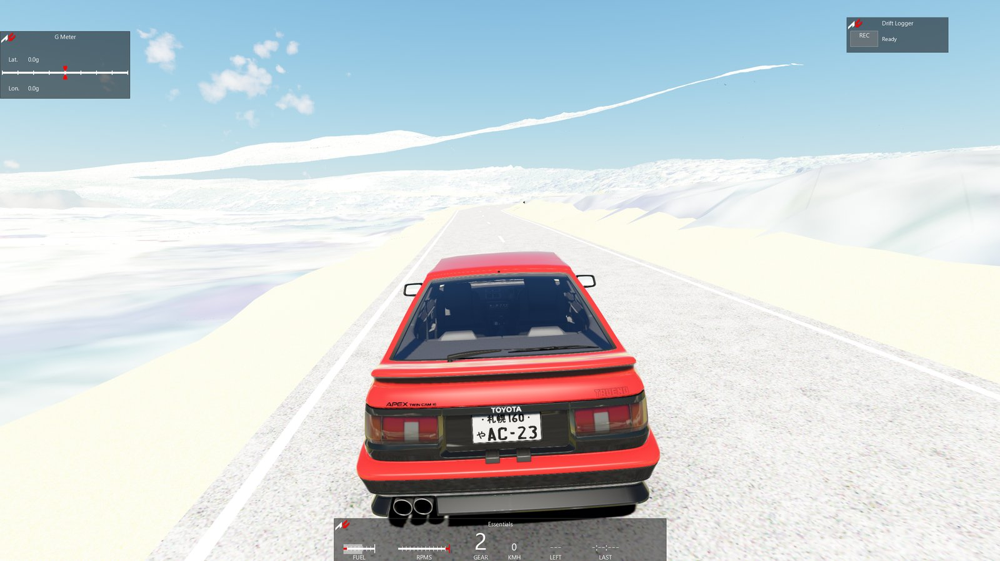

# Tutoriel / Tutorial — de zéro à la piste dans Assetto Corsa

**🇫🇷 [Français](#-français) · 🇬🇧 [English](#-english)**

---

## 🇫🇷 Français

Testé sur Windows 11, Python 3.13, Assetto Corsa + Content Manager + CSP.

### 0. Prérequis

- Python 3.11+ et Git
- Assetto Corsa
- ~1,5 Go d'espace disque par tronçon de ~17 km (dont ~1 Go de temporaire pour le LiDAR)

Blender et ksEditor ne sont plus nécessaires : `kn5_export.py` écrit la piste lui-même.

```powershell
git clone <ce dépôt> realroad
cd realroad
python -m venv .venv
.venv\Scripts\activate          # à refaire dans chaque nouveau terminal
pip install -r requirements.txt
```

### 1. Décrire le tronçon

Dans `config.yaml` : points de départ/arrivée, numéro de route (`osm_ref_regex`)
et section `track` (identifiant AC, titre, largeur, lissage, marquages…).

### 2. Tout lancer (~30 min la première fois)

```powershell
python realroad.py --install "C:\Program Files (x86)\Steam\steamapps\common\assettocorsa"
```

Les étapes s'affichent une à une. À vérifier au passage (dans `data\<nom>\`) :

| Fichier | Ce qu'on regarde |
|---|---|
| `route_wgs84.geojson` | le tracé, sur [geojson.io](https://geojson.io) |
| `road_profile.png` | altitude, pentes, ponts |
| `road_edges.png` | largeur mesurée vs BD TOPO, bords sur l'orthophoto |
| `road_markings.png` | marquages détectés sur l'orthophoto |
| `trees.png` | arbres détectés (carte + histogramme des hauteurs) |
| `streetview_sheet.jpg` | la vraie route vue du conducteur, tous les 250 m (photos Panoramax) |

En cas d'erreur, corriger puis reprendre à l'étape concernée :
`python realroad.py --from road_edges --install "…"`.
Après un changement de `config.yaml` (lissage, largeur…), seules les dernières
étapes sont utiles : `python realroad.py --from build_track --install "…"`.

### 3. Rouler

Content Manager → **Drive → Quick Drive** → choisir la piste → mode **Practice**.



La piste contient aussi l'AI line (adversaires IA, mode Track Day), la minimap
(app « Map ») et des caméras TV pour les replays.

### 4. Arbres 3D (Custom Shaders Patch, facultatif)

CSP sait afficher de vrais arbres 3D (volume, vent, ombres) à la place des
arbres plats. Les modèles sont générés par `trees3d.py` ; il faut ensuite deux
outils une seule fois :

```powershell
python trees3d.py
& "C:\Program Files\Blender Foundation\Blender 5.2\blender.exe" -b -P blender_trees.py -- data\<nom>\csp_trees\src
```

Puis dans Content Manager → **Content → Tools → Creator tools → Tree converter**,
pour chacun des 4 fichiers `data\<nom>\csp_trees\*.fbx` (`pine_a`, `pine_b`,
`oak`, `shrub`) : choisir le `.fbx`, enregistrer le `.bin` **au même endroit et
sous le même nom** (`pine_a.bin`…). Dès que les 4 `.bin` sont là,
`python realroad.py --from build_track --install "…"` place les ~37 000 arbres
LiDAR en 3D (liste `extension\trees\realroad_trees.txt`). Pour revenir aux
arbres plats : `track.csp_trees: false`.

### Problèmes rencontrés

| Symptôme | Cause / solution |
|---|---|
| `No module named …` | le venv n'est pas activé (`.venv\Scripts\activate`) |
| `Orthophotos only cover N %` | téléchargement interrompu : relancer `python fetch.py ortho` |
| `HTTP 429` sur le LiDAR | limite de l'IGN : ne pas utiliser `--remote` |
| Petites bosses en roulant | augmenter `track.z_sigma_m` dans `config.yaml` |
| Voitures à l'envers au départ | `python kn5_export.py --spawn-flip --install "…"` |
| Le jeu plante au chargement à cause de l'IA | `python kn5_export.py --no-ai --install "…"` |
| Terrain trop clair / trop sombre | `track.materials` dans `config.yaml` (ksAmbient, ksDiffuse) |
| Fichier `.kn5` trop gros | `track.ortho_texture_px: 1024` |
| Trop d'arbres / jeu qui rame | `trees: {max_trees: 20000}` ou `max_distance_m: 80` dans `config.yaml`, puis `python realroad.py --from trees --install "…"` |
| Pas d'arbres / de bâtiments | ces étapes sont facultatives : relancer `python fetch.py mnh` / `python fetch.py buildings` |
| Pas de glissières ni de murets | relancer `python fetch.py roadside` (points LiDAR hors sol, quelques Mo) |
| Trop de buissons | `trees: {shrubs: false}` ou `shrub_max_distance_m: 20`, puis `python realroad.py --from trees --install "…"` |
| Balises J6 gênantes | `track.furniture_posts: false` ; tout le mobilier : `track.furniture: false` |
| Herbe CSP absente / partout | ajuster `[GRASS_FX]` dans `content\tracks\<id>\extension\ext_config.ini` (seuils `MASK_…`), ou supprimer la section |

### Ancienne méthode (Blender + ksEditor)

Toujours possible, par exemple pour retoucher la scène à la main :

```powershell
& "C:\Program Files\Blender Foundation\Blender 5.2\blender.exe" --factory-startup -b -P blender_export.py -- data\<nom>\track_build
```

puis `assettocorsa\sdk\editor\ksEditor.exe` : **File → Open FBX**, régler les
matériaux (ksAmbient ~0,45, ksDiffuse ~0,35, ksSpecular 0 pour le terrain :
les valeurs par défaut de ksEditor donnent un terrain blanc), **File → Save KN5
→ track** sous `track_build\ac_track\<id>\<id>.kn5`, et copier le dossier dans
`content\tracks`.

---

## 🇬🇧 English

Tested on Windows 11, Python 3.13, Assetto Corsa + Content Manager + CSP.

### 0. Requirements

- Python 3.11+ and Git
- Assetto Corsa
- ~1.5 GB of disk per ~17 km section (~1 GB of it temporary, for the LiDAR)

Blender and ksEditor are no longer needed: `kn5_export.py` writes the track itself.

```powershell
git clone <this repo> realroad
cd realroad
python -m venv .venv
.venv\Scripts\activate          # again in every new terminal
pip install -r requirements.txt
```

### 1. Describe the section

In `config.yaml`: start/end points, road number (`osm_ref_regex`) and the
`track` section (AC id, title, width, smoothing, markings…).

### 2. Run everything (~30 min the first time)

```powershell
python realroad.py --install "C:\Program Files (x86)\Steam\steamapps\common\assettocorsa"
```

Steps are shown one by one. Worth checking on the way (in `data\<name>\`):

| File | What to look at |
|---|---|
| `route_wgs84.geojson` | the centreline, on [geojson.io](https://geojson.io) |
| `road_profile.png` | elevation, grades, bridges |
| `road_edges.png` | measured width vs BD TOPO, edges on the orthophoto |
| `road_markings.png` | detected markings on the orthophoto |
| `trees.png` | detected trees (map + height histogram) |
| `streetview_sheet.jpg` | the real road seen from the driver's seat every 250 m (Panoramax photos) |

On an error, fix it and resume at that step:
`python realroad.py --from road_edges --install "…"`.
After changing `config.yaml` (smoothing, width…), only the last steps are
needed: `python realroad.py --from build_track --install "…"`.

### 3. Drive

Content Manager → **Drive → Quick Drive** → pick the track → **Practice** mode.


The track also has an AI line (AI opponents, Track Day mode), a minimap
("Map" app) and TV cameras for replays.

### 4. 3D trees (Custom Shaders Patch, optional)

CSP can draw real 3D trees (volume, wind, shadows) instead of the flat ones.
`trees3d.py` generates the models; two tools are then needed once:

```powershell
python trees3d.py
& "C:\Program Files\Blender Foundation\Blender 5.2\blender.exe" -b -P blender_trees.py -- data\<name>\csp_trees\src
```

Then in Content Manager → **Content → Tools → Creator tools → Tree converter**,
for each of the 4 files `data\<name>\csp_trees\*.fbx` (`pine_a`, `pine_b`,
`oak`, `shrub`): pick the `.fbx`, save the `.bin` **in the same folder under the
same name** (`pine_a.bin`…). Once the 4 `.bin` are there,
`python realroad.py --from build_track --install "…"` places the ~37,000 LiDAR
trees in 3D (list `extension\trees\realroad_trees.txt`). Back to flat trees:
`track.csp_trees: false`.

### Troubleshooting

| Symptom | Cause / fix |
|---|---|
| `No module named …` | the venv is not active (`.venv\Scripts\activate`) |
| `Orthophotos only cover N %` | interrupted download: run `python fetch.py ortho` again |
| `HTTP 429` on LiDAR | IGN rate limit: don't use `--remote` |
| Small bumps while driving | raise `track.z_sigma_m` in `config.yaml` |
| Cars spawn facing backwards | `python kn5_export.py --spawn-flip --install "…"` |
| Game crashes on load because of the AI | `python kn5_export.py --no-ai --install "…"` |
| Terrain too bright / too dark | `track.materials` in `config.yaml` (ksAmbient, ksDiffuse) |
| `.kn5` file too big | `track.ortho_texture_px: 1024` |
| Too many trees / low frame rate | `trees: {max_trees: 20000}` or `max_distance_m: 80` in `config.yaml`, then `python realroad.py --from trees --install "…"` |
| No trees / buildings | these steps are optional: run `python fetch.py mnh` / `python fetch.py buildings` again |
| No guard rails or walls | run `python fetch.py roadside` (above-ground LiDAR points, a few MB) |
| Too many bushes | `trees: {shrubs: false}` or `shrub_max_distance_m: 20`, then `python realroad.py --from trees --install "…"` |
| Edge posts in the way | `track.furniture_posts: false`; all the furniture: `track.furniture: false` |
| CSP grass missing / everywhere | tune `[GRASS_FX]` in `content\tracks\<id>\extension\ext_config.ini` (the `MASK_…` thresholds), or delete the section |

### Old route (Blender + ksEditor)

Still works, e.g. to touch the scene up by hand:

```powershell
& "C:\Program Files\Blender Foundation\Blender 5.2\blender.exe" --factory-startup -b -P blender_export.py -- data\<name>\track_build
```

then `assettocorsa\sdk\editor\ksEditor.exe`: **File → Open FBX**, set the
materials (ksAmbient ~0.45, ksDiffuse ~0.35, ksSpecular 0 for the terrain:
ksEditor's defaults make the terrain white), **File → Save KN5 → track** as
`track_build\ac_track\<id>\<id>.kn5`, and copy the folder into `content\tracks`.
